  <picture>
    <source media="(prefers-color-scheme: dark)" srcset="../../assets/brand/banner-dark.svg">
    
  </picture>

  
  
  
  
  

  <a href="../../README.md">English</a> ｜ <a href="../../assets/docs/README.zh.md">简体中文</a> ｜ <a href="../../assets/docs/README.zh-tw.md">繁體中文</a> ｜ <a href="../../assets/docs/README.ja.md">日本語</a> ｜ <a href="../../assets/docs/README.fr.md">Français</a> ｜ <a href="../../assets/docs/README.ru.md">Русский</a>

Pianpker は [Drag0nM](https://github.com/DRAG0NM) の個人ブログプロジェクトです。文章を中心に、意図的な余白、和紙を思わせる暖色、墨の濃淡、控えめな朱色によって、静かで明快な読書体験を目指します。

表面的な「和風」の装飾ではなく、侘寂、幽玄、物哀、「間」を組版とリズムの原則として扱います。内容は複雑であっても、表現形式は簡素であり、すべての要素に存在する理由が必要です。

Astro 6 と UnoCSS を基盤とし、多言語コンテンツ、明暗テーマ、ClientRouter、Markdown/MDX、KaTeX、Mermaid、目次、画像処理、RSS、Open Graph、レスポンシブ表示、印刷に対応します。このほか、墨を思わせるモーション（墨の滴によるテーマ切り替えと、ブロックごとに書き換える言語切り替え）、傍注、読書位置の記憶を備えています。詳しくは「テーマ使用ガイド」を参照してください。

Pianpker は radishzz による [Retypeset](https://github.com/radishzzz/astro-theme-retypeset) を基に大幅なカスタマイズを行った派生プロジェクトです。元の著作権表示と MIT License は [`LICENSE`](../../LICENSE) に保持されています。詳細は [`NOTICE.md`](../../NOTICE.md) を参照してください。

開発・ビルド・デプロイ方法はルートの [README](../../README.md) にあります。
