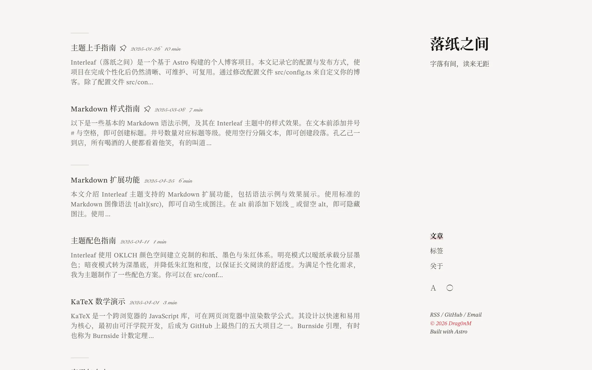
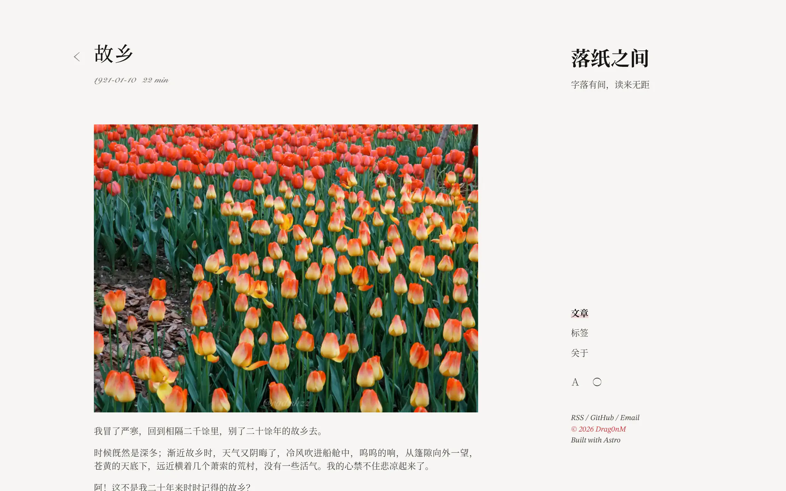
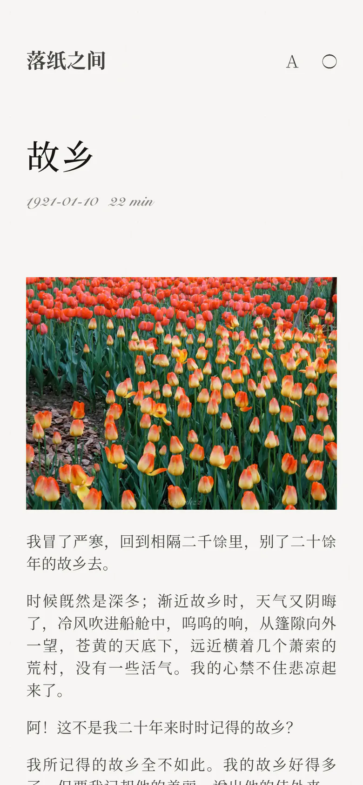
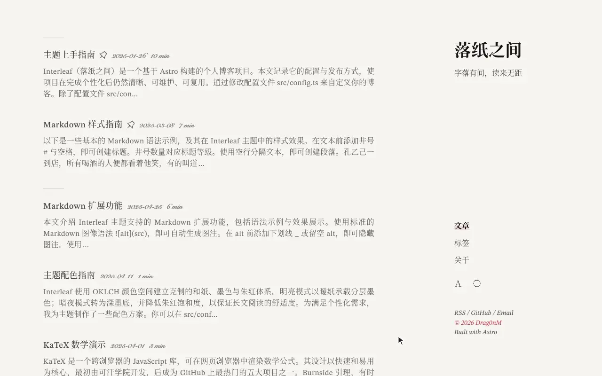
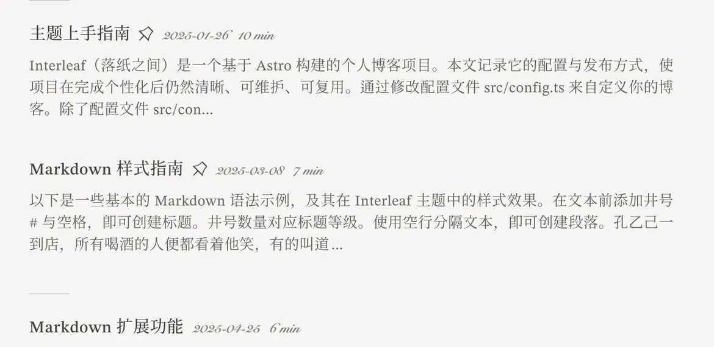
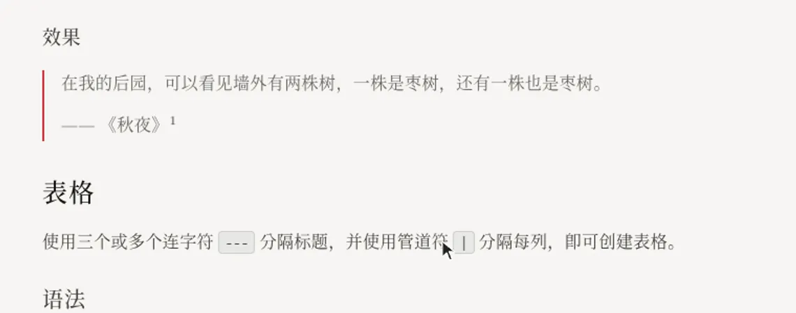
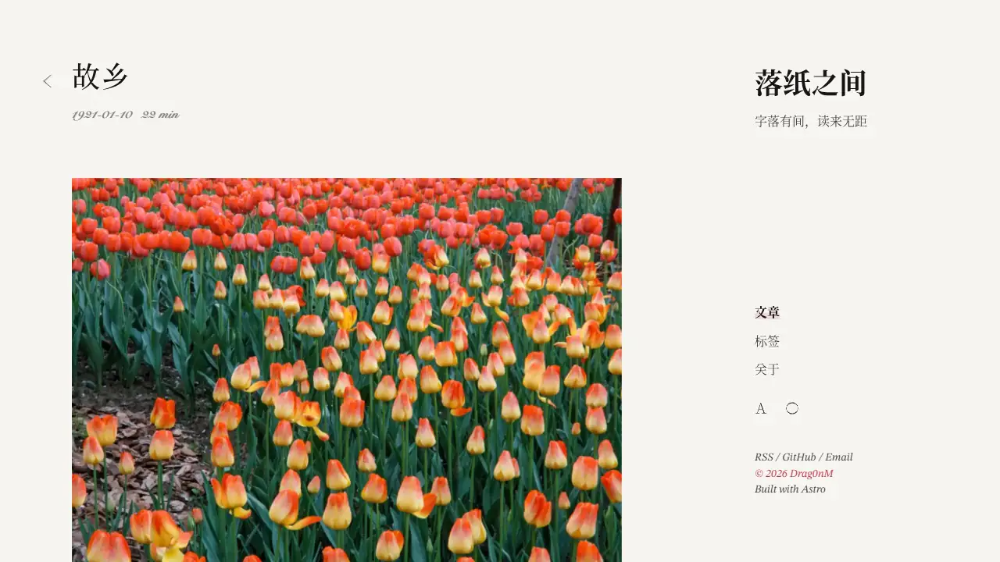

  <picture>
    <source media="(prefers-color-scheme: dark)" srcset="../../assets/brand/banner-dark.svg">
    
  </picture>

  <i>字落有間，讀來無距。</i>

  
  
  
  
  

  <a href="../../README.md">English</a> ｜ <a href="../../assets/docs/README.zh.md">简体中文</a> ｜ <a href="../../assets/docs/README.zh-tw.md">繁體中文</a> ｜ <a href="../../assets/docs/README.ja.md">日本語</a> ｜ <a href="../../assets/docs/README.fr.md">Français</a> ｜ <a href="../../assets/docs/README.ru.md">Русский</a>

<picture>
  <source media="(max-width: 640px) and (prefers-color-scheme: dark)" srcset="../images/v1.1/home-mobile-dark.webp">
  <source media="(max-width: 640px)" srcset="../images/v1.1/home-mobile-light.webp">
  <source media="(prefers-color-scheme: dark)" srcset="../images/v1.1/home-desktop-dark.webp">
  
</picture>

Interleaf 是 [Drag0nM](https://github.com/DRAG0NM) 的個人部落格專案。它以文字閱讀為中心，用克制的留白、和紙暖色、墨色層次與少量朱紅，建立安靜而清晰的數位排版體驗。

## 設計原則

- 不用表面的「日式」裝飾取代排版思考；
- 以侘寂、幽玄、物哀與「間」組織空間和節奏；
- 內容可以複雜，形式盡可能簡單；
- 每一個視覺元素都應有存在的理由。

## 技術與功能

專案基於 Astro 6 與 UnoCSS，支援多語言內容、明暗主題、ClientRouter、Markdown/MDX、KaTeX、Mermaid、目錄、圖片處理、RSS、Open Graph、響應式佈局與列印。此外還有水墨意趣的動效（墨滴式主題切換與逐塊重寫的語言切換）、邊欄旁註和記憶閱讀位置，詳見《主題上手指南》。

  <picture>
    <source media="(prefers-color-scheme: dark)" srcset="../images/v1.1/post-desktop-dark.webp">
    
  </picture>
  &nbsp;
  <picture>
    <source media="(prefers-color-scheme: dark)" srcset="../images/v1.1/post-mobile-dark.webp">
    
  </picture>

   
  明暗切換：墨滴落下暈開全頁，切回時墨跡收回；圖示化作新月

   
  語言切換：舊內容逐塊淡出，新語言逐塊書寫

   
  指向文章標題時，旁邊落下一枚朱印

   
  腳註在引用處展開為小卡片

   
  一線朱紅隨閱讀進度延伸

## 來源與授權

Interleaf 基於 radishzz 的 [Retypeset](https://github.com/radishzzz/astro-theme-retypeset) 深度定製。原始版權與 MIT 授權文字完整保留在倉庫根目錄的 [`LICENSE`](../../LICENSE) 中，詳情見 [`NOTICE.md`](../../NOTICE.md)。

完整的開發、構建與部署說明請閱讀倉庫根目錄的 [README](../../README.md)。
